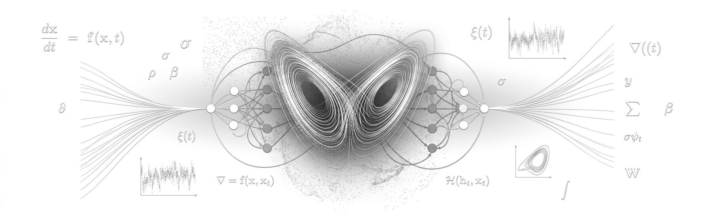
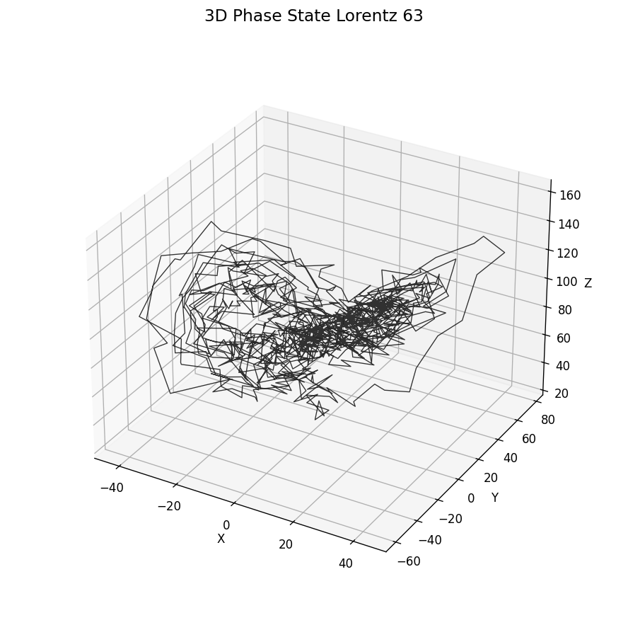
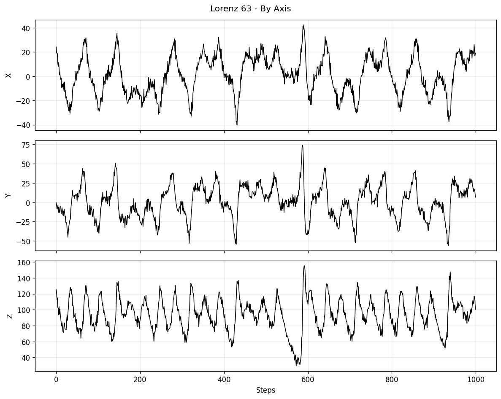
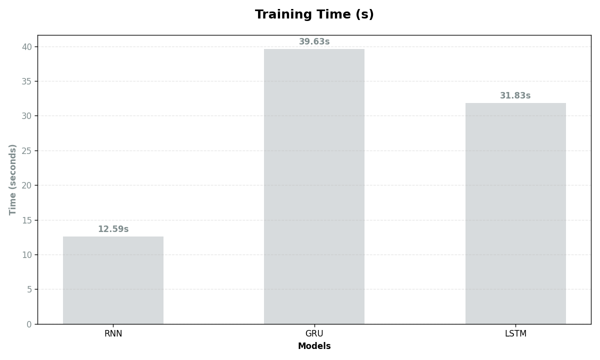
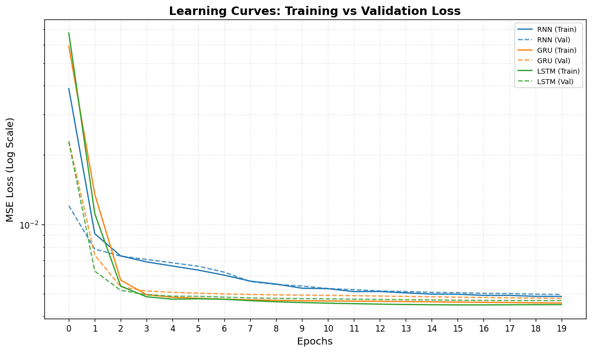
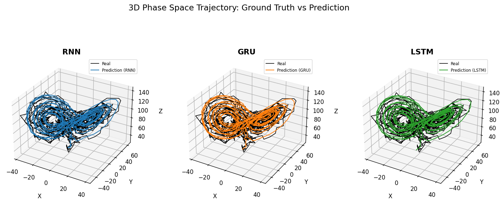
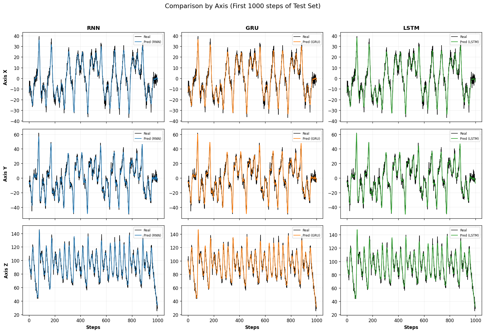
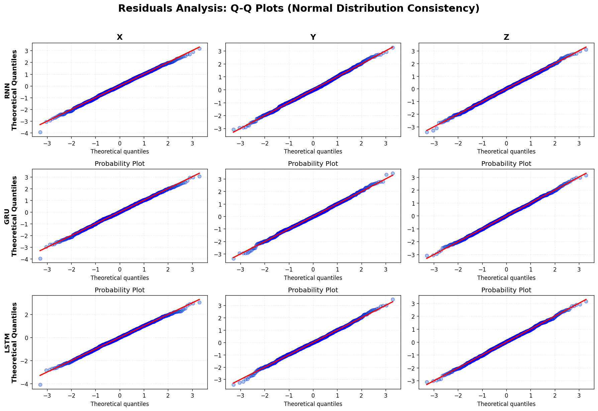

<div align="center">
  
</div>

# **Resilience Analysis of Recurrent Neural Networks in Predicting High-Turbulence Chaotic Systems under Stochastic Noise**
> This study investigates the predictive resilience of **Recurrent Neural Architectures** when subjected to **extreme chaotic regimes** and **stochastic interference**. While standard benchmarks focus on the stable Lorenz-63 attractor ($\rho=28$), we push the system into a high-turbulence state ($\sigma=12.96$, $\rho=99.96$) and introduce **20% additive Gaussian noise** to simulate real-world sensory uncertainty. We evaluate three core architectures: **Recurrent Neural Networks (RNN), Gated Recurrent Units (GRU), and Long Short-Term Memory (LSTM)** networks. The results demonstrate that all architectures exhibit robust filtering capabilities, with residual analysis via Q-Q plots showing a near-perfect adherence to normal distribution, proving that the models successfully decoupled the underlying deterministic physics from the stochastic noise.

## Research Question
Can recurrent neural architectures extract and preserve the deterministic dynamics of a high-turbulence chaotic system when observations are corrupted by significant stochastic noise?
Rather than evaluating models only on short-term pointwise accuracy in a well-behaved chaotic regime, this project shifts the focus toward **topological and statistical consistency** under extreme conditions.
The research investigates three main questions:

1. Can recurrent architectures reconstruct the attractor manifold of the Lorenz-63 system under extreme chaos ($\sigma=12.96$, $\rho=99.96$)?
2. How resilient are RNN, GRU, and LSTM to 20% additive Gaussian noise in this regime?
3. Do the models act as non-linear observers, effectively decoupling deterministic physics from stochastic residuals?

## Experimental Setup
The experiment investigates the predictive resilience of recurrent neural architectures in a high-turbulence Lorenz-63 system under 20% additive stochastic noise. The framework is designed to provide a reproducible and controlled comparison across architectures.

### Overview of the Experimental Framework
The experimental framework consists of the following stages:
- Dynamical system definition and parameter configuration
- Numerical integration and noise injection
- Data preprocessing and normalization
- Supervised sequence formulation
- Model training and hyperparameter unification
- Evaluation via RMSE and residual analysis (Q-Q plots)

### Dynamical System and Extreme Chaotic Regime
We consider the **Lorenz-63 system**, a prototypical low-dimensional chaotic dynamical system. While often studied in its canonical stable regime, this work focuses on a **High-Turbulence regime** to evaluate neural resilience. The system is defined by the following coupled nonlinear ordinary differential equations:

$$
\frac{dx}{dt} = \sigma(y - x), \quad
\frac{dy}{dt} = x(\rho - z) - y, \quad
\frac{dz}{dt} = xy - \beta z
$$

To induce extreme chaotic behavior, we set the parameters to $\sigma = 12.96$, $\beta = 8/3$, and an elevated Rayleigh number of $\rho = 99.96$.

### Data Generation and Noise Condition
The system is numerically integrated using a classical fourth-order Runge-Kutta (RK4) scheme with a fixed time step of $\Delta t = 0.01$. A total of **11,000 integration steps** were performed, with the first **1,000 steps discarded** to remove transient effects.

To simulate realistic observational uncertainty, a **20% additive Gaussian noise** was injected into the ground-truth trajectory:

$$
s_{noisy}(t) = s_{true}(t) + \eta, \quad \eta \sim \mathcal{N}(0, \sigma_{\eta}^2)
$$

where $\sigma_{\eta}$ represents 20% of the standard deviation of each respective state variable. All simulations were initialized from the state $(1, 1, 1)$.

<div align="center">
  
  <p align="center"><strong style="font-size: small;">Figure 1. Phase space visualization of the turbulent Lorenz-63 system under 20% stochastic noise.</strong></p>
</div>


<div align="center">
  
  <p align="center"><strong style="font-size: small;">Figure 2: Component-wise time-series representation of the noisy ground truth. The extreme complexity
and erratic transitions of the turbulent regime are evident across all axes.</strong></p>
</div>


### Time Series Preprocessing
All state variables are normalized independently using **Min-Max scaling** to the range $[-1, 1]$, with parameters estimated exclusively from the training set:

$$
x_{norm} = 2 \cdot \frac{x - x_{min}}{x_{max} - x_{min}} - 1
$$

The continuous-time trajectory is reformulated as a discrete supervised learning problem using a **sliding window embedding** (delay coordinate embedding). Each input is a sequence of $L = 100$ consecutive time steps of the 3D state:

$$
X_t =
\begin{bmatrix}
(x_{t-L}, y_{t-L}, z_{t-L}) \\
\vdots \\
(x_{t-1}, y_{t-1}, z_{t-1})
\end{bmatrix}
\in \mathbb{R}^{L \times 3}
$$

The target corresponds to the next-step prediction of the full system state:

$$
y_t = (x_t, y_t, z_t) \in \mathbb{R}^3
$$

This defines a one-step-ahead forecasting problem in phase space, where the model learns an approximation of the discrete-time flow map $\Phi_{\Delta t}: \mathbb{R}^3 \rightarrow \mathbb{R}^3$.

### Machine Learning Pipeline
The pipeline was implemented in Python using PyTorch, numpy, and scikit-learn, following the main stages:

- **Load Database:** Generate and load the noisy Lorenz-63 trajectory.
- **Compute Input Features:** Build sliding window sequences of length $L=100$.
- **Compute Output Feature:** Define the one-step-ahead 3D state prediction.
- **Model Configuration:** Unified hyperparameters across all architectures.
- **Model Training:** Train RNN, GRU, and LSTM models.
- **Model Evaluation:** Evaluate on validation and test sets via RMSE.
- **Residual Analysis:** Q-Q plots for statistical decoupling assessment.

### Recurrent Architectures

The following neural architectures were evaluated under identical conditions:

- Recurrent Neural Network (RNN)
- Gated Recurrent Unit (GRU)
- Long Short-Term Memory (LSTM)

<div align="center">
  <p><strong>Table 1. Unified hyperparameter configuration across all architectures</strong></p>

  <table>
    <tr>
      <th>Hyperparameter</th>
      <th>Value / Specification</th>
    </tr>
    <tr><td>Hidden Dimension</td><td>64 units</td></tr>
    <tr><td>Learning Rate</td><td>1e-3</td></tr>
    <tr><td>Optimization</td><td>Adam</td></tr>
    <tr><td>Loss Function</td><td>Mean Squared Error (MSE)</td></tr>
    <tr><td>Training Budget</td><td>20 Epochs</td></tr>
    <tr><td>Batch Size</td><td>128</td></tr>
  </table>
</div>

### Evaluation Metrics

Model performance was evaluated using metrics that capture both local accuracy and statistical consistency:

**Root Mean Squared Error (RMSE)**

$$
RMSE_k = \sqrt{\frac{1}{N} \sum_{i=1}^{N} \left( y_i^{(k)} - \hat{y}_i^{(k)} \right)^2}
$$

where $y_i^{(k)}$ represents the noisy ground-truth observation and $\hat{y}_i^{(k)}$ is the model's one-step-ahead prediction for state variable $k \in \{x, y, z\}$.

**Residual Analysis and Q-Q Plots**

$$
\epsilon_i^{(k)} = y_i^{(k)} - \hat{y}_i^{(k)}
$$

The structural fidelity is assessed via Quantile-Quantile (Q-Q) plots, which compare the empirical quantiles of $\epsilon$ against the theoretical quantiles of a standard normal distribution $\mathcal{N}(0, 1)$. Linear adherence implies:

$$
\hat{y}_i^{(k)} \approx s_{true, i}^{(k)} \implies \epsilon_i^{(k)} \sim \mathcal{N}(0, \sigma_{\eta}^2)
$$

> Obs: This linear adherence serves as a formal proof that the model has successfully decoupled the deterministic dynamics from the Gaussian noise, effectively acting as a non-linear state observer.

## Results

### Training Metrics and Convergence Dynamics
A total of **three recurrent architectures** were trained for 20 epochs under identical conditions. The RNN was significantly faster (**12.59s**) compared to the gated architectures, with the GRU requiring the highest computational effort (**39.63s**) and the LSTM showing intermediate performance (**31.83s**).

<div align="center">
  
  <p align="center"><strong>Figure 3. Total training time for 20 epochs per architecture.</strong></p>
</div>

Despite the varying computational costs, all architectures achieved efficient and stable convergence. The training and validation loss curves (MSE) are tightly coupled, serving as crucial evidence of strong generalization and **no overfitting to the 20% noise floor**.

<div align="center">
  
  <p align="center"><strong>Figure 3. Learning curves (Training vs. Validation MSE Loss).</strong></p>
</div>

### Pointwise Predictive Accuracy
Tables 2 and 3 summarize the **Root Mean Squared Error (RMSE)** for the validation and test sets independently. Despite the extreme chaos and 20% observational noise, the models maintained stable predictive accuracy across all evaluation phases.

<div align="center">
  <p><strong>Table 2. Validation RMSE performance per architecture</strong></p>

  <table>
    <tr>
      <th>Model</th>
      <th>X RMSE</th>
      <th>Y RMSE</th>
      <th>Z RMSE</th>
    </tr>
    <tr><td>RNN</td><td>3.460506</td><td>4.714817</td><td>4.328972</td></tr>
    <tr><td>GRU</td><td>3.457373</td><td>4.526897</td><td>4.204965</td></tr>
    <tr><td>LSTM</td><td>3.41793</td><td>4.441972</td><td>4.186257</td></tr>
  </table>
</div>

<div align="center">
  <p><strong>Table 3. Test RMSE performance per architecture</strong></p>

  <table>
    <tr>
      <th>Model</th>
      <th>X RMSE</th>
      <th>Y RMSE</th>
      <th>Z RMSE</th>
    </tr>
    <tr><td>RNN</td><td>3.249623</td><td>4.64957</td><td>4.331968</td></tr>
    <tr><td>GRU</td><td>3.266047</td><td>4.447664</td><td>4.131323</td></tr>
    <tr><td>LSTM</td><td>3.251254</td><td>4.386068</td><td>4.144141</td></tr>
  </table>
</div>


The numerical results reveal a high degree of predictive consistency across all evaluated architectures. Notably, the RMSE values for the test set remain within the same order of magnitude as the validation metrics, indicating excellent generalization without overfitting the 20% stochastic floor. **Gated architectures (LSTM and GRU) outperformed the vanilla RNN**, albeit by a narrow margin, suggesting that their internal gating mechanisms provide a superior inductive bias for handling the rapid phase-space transitions of the system regime.

### Phase-Space Resilience and Noise Filtering
The visual analysis of the 3D trajectories confirms that the networks did not diverge from the attractor manifold. Even with significant stochastic interference, the models reconstructed the "butterfly" geometry with fidelity.

<div align="center">
  
  <p align="center"><strong>Figure 4. Phase-space reconstruction of the turbulent Lorenz attractor.</strong></p>
</div>

The resilience to noise is further validated by the component-wise comparison. While the ground truth signals exhibit high-frequency oscillations, the neural predictions provide a **smoothed trajectory** that tracks the deterministic backbone of the system.

<div align="center">
  
  <p align="center"><strong>Figure 5. Time-series comparison for X, Y, and Z components.</strong></p>
</div>

### Statistical Decoupling of Noise
The **Quantile-Quantile (Q-Q) plots** provide the ultimate proof of dynamical consistency. The residuals for all three models show a near-linear adherence to the theoretical normal distribution. This confirms that the models successfully internalized the deterministic Lorenz flow, leaving the **stochastic noise as the only remaining error component**.

<div align="center">
  
  <p align="center"><strong>Figure 6. Q-Q plots of prediction residuals for RNN, GRU, and LSTM.</strong></p>
</div>

## Findings
- Three recurrent architectures (RNN, GRU, LSTM) were evaluated in a high-turbulence Lorenz-63 regime ($\sigma=12.96$, $\rho=99.96$) under 20% additive Gaussian noise.
- All architectures achieved stable convergence with tightly coupled training and validation losses, indicating no overfitting to the noise floor.
- Gated architectures (LSTM and GRU) outperformed the vanilla RNN in RMSE, confirming the benefit of gating mechanisms in high-chaos regimes.
- The RNN was the fastest to train (12.59s), while the GRU required the most computational effort (39.63s).
- Phase-space reconstruction confirmed that all models preserved the topological integrity of the attractor.
- Q-Q plots revealed near-linear residual distributions, proving successful decoupling of deterministic physics from stochastic noise.
- The models acted as effective **non-linear state observers**, filtering observational uncertainty without losing dynamical consistency.

## Limitations and Future Work
- The study is limited to the three-dimensional Lorenz-63 system.
- The 20% noise level represents a specific observational uncertainty regime; other noise structures may yield different resilience profiles.
- Future work may explore higher-dimensional chaotic systems (e.g., Lorenz-96, Kuramoto-Sivashinsky).
- Integration of physics-informed constraints (Hamiltonian Neural Networks, PINNs) may further enhance structural and topological stability.
- Adaptive window lengths and attention mechanisms could be investigated for improved long-horizon prediction.

## References
1. Strogatz, S. H. (2018). *Nonlinear Dynamics and Chaos*. CRC Press.
2. Lorenz, E. N. (1963). *Deterministic Nonperiodic Flow*. Journal of the Atmospheric Sciences, 20(2), 130–141.
3. Takens, F. (1981). *Detecting strange attractors in turbulence*. Dynamical Systems and Turbulence, 898–919.
4. Rumelhart, D. E., Hinton, G. E., & Williams, R. J. (1986). *Learning representations by back-propagating errors*. Nature, 323(6088), 533–536.
5. Cho, K., et al. (2014). *Learning Phrase Representations using RNN Encoder-Decoder for Statistical Machine Translation*. EMNLP.
6. Hochreiter, S., & Schmidhuber, J. (1997). *Long Short-Term Memory*. Neural Computation, 9(8), 1735–1780.
7. Brunton, S. L., & Kutz, J. N. (2022). *Data-Driven Science and Engineering*. Cambridge University Press.
8. Greydanus, S., Dzamba, M., & Yosinski, J. (2019). *Hamiltonian Neural Networks*. NeurIPS.

## Project Structure
```text
📦 quantyma-lorenz-rnn-resilience
┣ 📂 data
┣ 📂 images
┣ 📂 notebooks
┃ ┣ 📜 01-data-generation.ipynb
┃ ┣ 📜 02-noise-injection.ipynb
┃ ┣ 📜 03-sequence-embedding.ipynb
┃ ┣ 📜 04-model-training.ipynb
┃ ┗ 📜 05-residual-analysis.ipynb
┣ 📂 src
┃ ├ 📜 lorenz.py
┃ ├ 📜 noise.py
┃ ├ 📜 dataset.py
┃ ├ 📜 models.py
┃ ├ 📜 train.py
┃ └ 📜 evaluate.py
┣ 📜 README.md
┣ 📜 requirements.txt
┗ 📜 LICENSE
```
## Setup, Hardware & Execution

### 1. Hardware & OS Environment (Original Workstation)
The results were obtained using this specific configuration to ensure reproducibility:
- **Host Model:** Lenovo ThinkPad E14 Gen 5 (21JS000SBO)
- **OS:** Debian GNU/Linux 13.4 (Bookworm)
- **CPU:** AMD Ryzen 7 7730U (8-Core / 16-Threads)
- **GPU:** AMD Radeon Graphics (Barcelo)
- **RAM:** 16GB LPDDR4
- **Environment:** Local Research Station

### Installation & Execution Script
Run the commands below to configure the environment and start the experiment:

```bash
# Update system, install dependencies, configure Python environment and run
sudo apt update && sudo apt install curl git -y && \
curl -fsSL [https://pyenv.run](https://pyenv.run) | bash && \
export PATH="$HOME/.pyenv/bin:$PATH" && \
eval "$(pyenv init -)" && \
eval "$(pyenv virtualenv-init -)" && \
pyenv install 3.11.8 && \
pyenv local 3.11.8 && \
curl -sSL [https://install.python-poetry.org](https://install.python-poetry.org) | python3 - && \
export PATH="$HOME/.local/bin:$PATH" && \
poetry config virtualenvs.in-project true && \
poetry install && \
poetry run jupyter notebook src/experiment.ipynb

___
## Know the Author:


<p align="right">
  <a href="https://www.linkedin.com/in/bpriantti/">
    
  </a>
</p>
