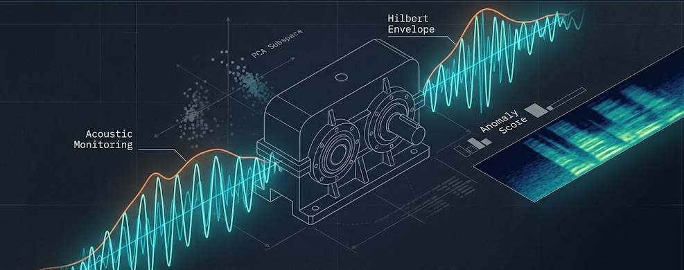
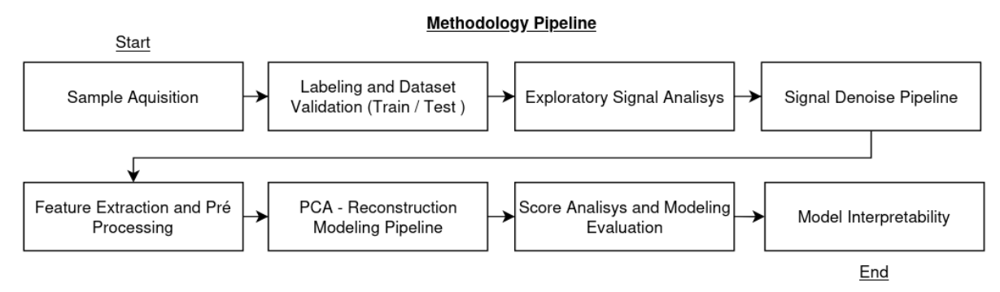
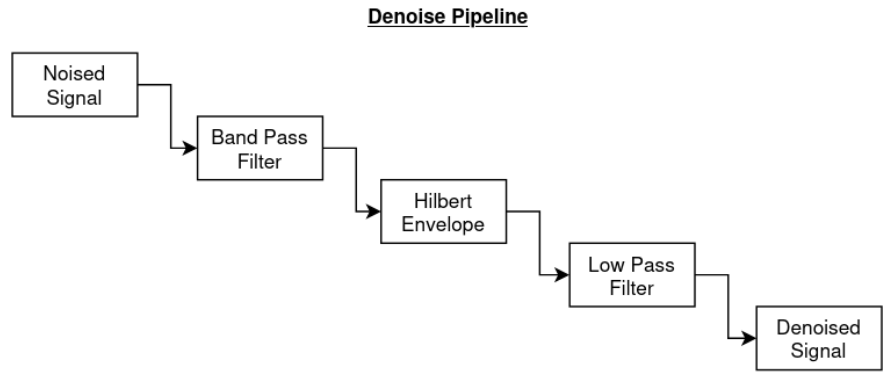
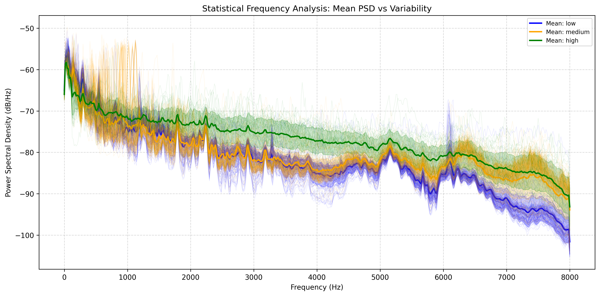
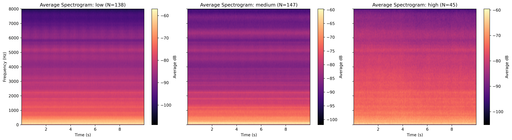
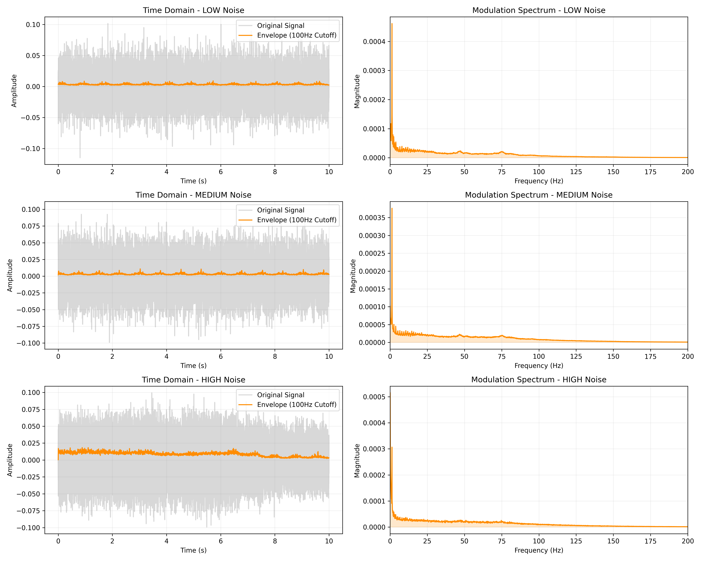
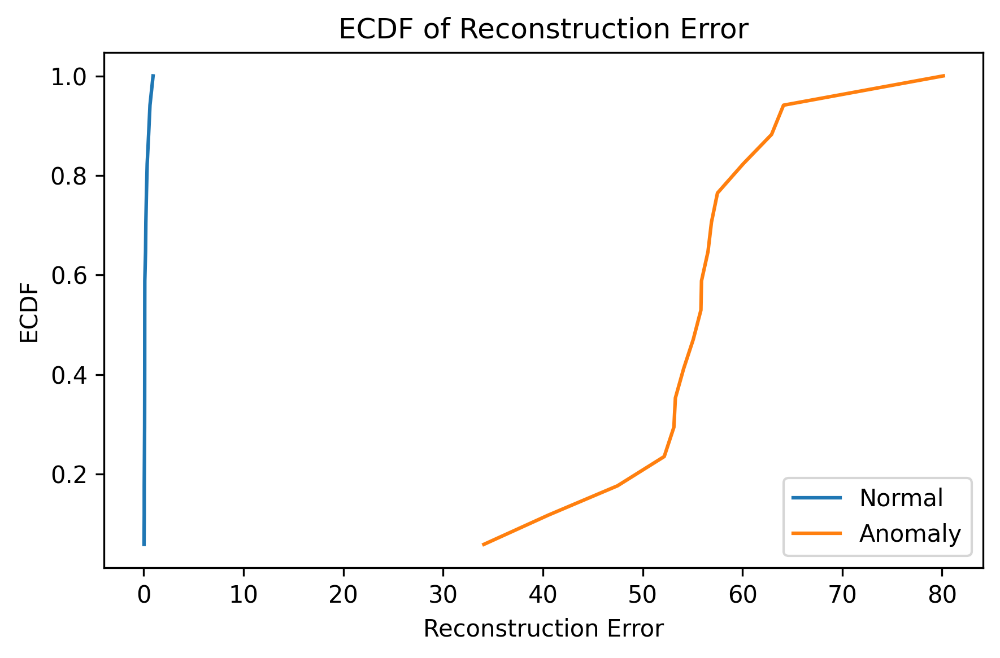
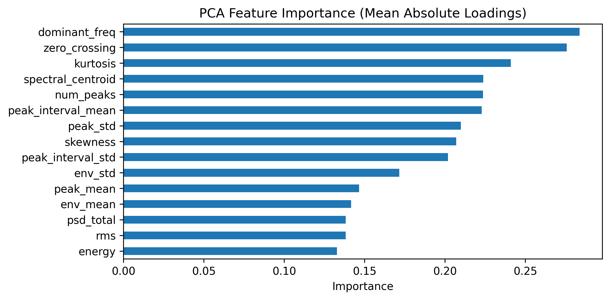

<div align="center">
  
</div>

# **Anomaly Detection in Industrial Gearbox Systems Using Acoustic Signals Under Highly Noise Background**
> This paper proposes a robust framework for **mechanical health monitoring** based on **signal conditioning** and **unsupervised subspace learning**. The methodology employs a signal conditioning pipeline based on **bandpass filtering** and **Hilbert Transform envelope extraction** to isolate amplitude-modulated components associated with gear meshing irregularities. These features are projected into a **principal component subspace**, where anomalies are identified through **reconstruction error analysis**. Validated on a public industrial benchmark dataset representative of real-world conditions, the proposed system achieved complete separation between normal and anomalous conditions, reaching scores of **0.99 for AUC, Precision, and Recall** across multiple noise intensities.

## Research Question
Can physically grounded signal processing combined with unsupervised subspace learning detect gearbox anomalies in acoustic signals under severe industrial noise?
Rather than relying on raw time-domain metrics or generic machine learning pipelines, this project uses a **denoising pipeline** that isolates amplitude-modulated components linked to gear meshing irregularities, followed by **PCA-based reconstruction error analysis**.
The research investigates three main questions:

1. Can fault-induced acoustic signatures be isolated from background industrial noise through signal conditioning?
2. Can a low-dimensional PCA subspace learned exclusively from healthy data separate normal from anomalous conditions?
3. Does the resulting anomaly detector remain robust across different noise intensities (low, medium, high)?

## Experimental Setup
The experiment investigates anomaly detection in industrial gearbox acoustic signals under highly noisy backgrounds. The framework is designed to provide a reproducible and physically interpretable solution for predictive maintenance.

### Overview of the Experimental Framework
The experimental framework consists of the following stages:
- Sample acquisition and dataset organization
- Labeling and dataset validation (train/test)
- Exploratory signal analysis (PSD, spectrogram, statistical descriptors)
- Signal conditioning and denoising pipeline
- Feature extraction (time, frequency, envelope domains)
- Feature preprocessing and standardization
- PCA-based anomaly detection
- Score distribution and threshold selection
- Model interpretability

<div align="center"> 
   
  <p align="center"><strong style="font-size: small;">Figure 1. Proposed methodology pipeline for industrial gearbox anomaly detection.</strong></p>
</div>

### Sample Acquisition and Experimental Setup
The proposed experimental setup considers acoustic acquisition from industrial gearboxes operating under both normal and faulty conditions. A fixed-position industrial measurement microphone is employed for single-channel audio acquisition.

The microphone is positioned near the gearbox housing at a fixed distance in order to ensure acquisition consistency and minimize variability caused by sensor displacement. Data collection occurs under realistic industrial operating conditions, including the presence of background factory noise, mechanical interference, and operational variability.

<div align="center">
  <p><strong>Table 1. Proposed acoustic acquisition configuration</strong></p>

  <table>
    <tr>
      <th>Parameter</th>
      <th>Specification</th>
    </tr>
    <tr><td>Microphone type</td><td>Industrial measurement microphone</td></tr>
    <tr><td>Reference model</td><td>Brüel & Kjær Type 4189</td></tr>
    <tr><td>Acquisition mode</td><td>Single-channel audio acquisition</td></tr>
    <tr><td>Microphone positioning</td><td>Fixed-position near gearbox housing</td></tr>
    <tr><td>Audio interface</td><td>Dedicated acquisition interface</td></tr>
    <tr><td>Bit depth</td><td>16-bit</td></tr>
    <tr><td>Sampling rate</td><td>44.1 kHz – 48 kHz</td></tr>
    <tr><td>Environment</td><td>Real industrial environment</td></tr>
    <tr><td>Noise conditions</td><td>Background factory and mechanical noise</td></tr>
  </table>
</div>

### Labeling and Dataset Validation
The acquired audio recordings are organized and indexed according to their operational and environmental characteristics. Samples are labeled according to their operating condition, resulting in binary classes corresponding to **normal** and **anomalous** behavior, with additional metadata related to environmental noise conditions (low, medium, high).

For anomaly detection experiments, the dataset is divided into **training** and **testing** subsets. The training set contains **only** samples associated with normal operating conditions. The testing set contains a combination of normal and anomalous samples acquired under different noise conditions in order to evaluate model robustness and generalization performance.

<div align="center">
  <p><strong>Table 2. Example of audio file naming organization</strong></p>

  <table>
    <tr>
      <th>File Name</th>
      <th>Status</th>
      <th>Noise Level</th>
    </tr>
    <tr><td>S001_normal_low.wav</td><td>Normal</td><td>Low</td></tr>
    <tr><td>S002_normal_medium.wav</td><td>Normal</td><td>Medium</td></tr>
    <tr><td>S003_anomaly_high.wav</td><td>Anomaly</td><td>High</td></tr>
  </table>
</div>

### Exploratory Signal Analysis
An exploratory analysis of the acquired acoustic signals is performed in both the time and frequency domains in order to identify relevant patterns associated with gearbox operating conditions.

**Power Spectral Density (Welch Method)**

$$
P_{xx}(f) = \frac{1}{K} \sum_{k=1}^{K} \frac{1}{U} \left| \sum_{n=0}^{N-1} x_k[n] w[n] e^{-j 2 \pi f n} \right|^2
$$

**Spectrogram (STFT)**

$$
X(t,f) = \sum_{n=-\infty}^{\infty} x[n] w[n-t] e^{-j2\pi fn}, \quad S(t,f) = |X(t,f)|^2
$$

**Statistical Descriptors**

$$
\mathrm{RMS} = \sqrt{\frac{1}{N} \sum_{n=1}^{N} x^2[n]}, \quad
\mathrm{Kurtosis} = \frac{\frac{1}{N} \sum_{n=1}^{N} (x[n] - \mu)^4}{\left(\frac{1}{N} \sum_{n=1}^{N} (x[n] - \mu)^2 \right)^2}, \quad
\mathrm{CF} = \frac{\max |x[n]|}{\mathrm{RMS}}
$$

### Signal Conditioning and Denoising Pipeline
Following the exploratory signal analysis, a dedicated signal conditioning and denoising pipeline was designed to enhance fault-related components — specifically those associated with gear meshing and cyclic impacts — while suppressing the interference from environmental industrial noise.

<div align="center">
  
  <p align="center"><strong style="font-size: small;">Figure 2. Flowchart of the proposed acoustic signal conditioning pipeline.</strong></p>
</div>

The pipeline is composed of four sequential stages:

**Bandpass Filtering**

$$
x_f[n] = (x * h)[n]
$$

**Hilbert Transform (Analytic Signal)**

$$
x_a(t) = x_f(t) + j \mathcal{H}\{x_f(t)\}
$$

**Envelope Extraction**

$$
e(t) = |x_a(t)|
$$

**Low-Pass Filtering**

$$
e_f(t) = (e * g)[t]
$$

### Feature Extraction
Each processed audio segment is mapped into a structured feature vector combining **time-domain statistics**, **spectral descriptors**, and **envelope-based measures**. Each group captures a different projection of the same underlying mechanical process, improving robustness and allowing linear subspace methods to separate normal operational variability from fault-induced deviations.

<div align="center">
  <p><strong>Table 3. Time-domain features</strong></p>

  <table>
    <tr>
      <th>Feature</th>
      <th>Equation</th>
      <th>Physical Interpretation</th>
    </tr>
    <tr><td>RMS</td><td>√(1/N · Σ y²[n])</td><td>Measures overall signal amplitude and vibration intensity.</td></tr>
    <tr><td>Energy</td><td>Σ y²[n]</td><td>Represents total acoustic energy contained in the signal segment.</td></tr>
    <tr><td>Kurtosis</td><td>K(y)</td><td>Captures impulsive behavior typically associated with localized faults.</td></tr>
    <tr><td>Skewness</td><td>S(y)</td><td>Measures asymmetry in the signal amplitude distribution.</td></tr>
    <tr><td>Zero-Crossing Rate</td><td>1/(N−1) · Σ |sign(y[n]) − sign(y[n−1])|</td><td>Estimates oscillatory behavior and waveform variability.</td></tr>
  </table>
</div>

<div align="center">
  <p><strong>Table 4. Frequency-domain features</strong></p>

  <table>
    <tr>
      <th>Feature</th>
      <th>Equation</th>
      <th>Physical Interpretation</th>
    </tr>
    <tr><td>Total Spectral Power</td><td>Σ P(f_i)</td><td>Measures total spectral energy across all frequency bins.</td></tr>
    <tr><td>Spectral Centroid</td><td>Σ f_i P(f_i) / Σ P(f_i)</td><td>Indicates the center of spectral energy concentration.</td></tr>
    <tr><td>Dominant Frequency</td><td>arg max P(f_i)</td><td>Identifies the frequency component with maximum spectral power.</td></tr>
  </table>
</div>

<div align="center">
  <p><strong>Table 5. Envelope-based features</strong></p>

  <table>
    <tr>
      <th>Feature</th>
      <th>Equation</th>
      <th>Physical Interpretation</th>
    </tr>
    <tr><td>Envelope Mean</td><td>μ(e)</td><td>Measures the average modulation amplitude of the signal envelope.</td></tr>
    <tr><td>Envelope Standard Deviation</td><td>σ(e)</td><td>Quantifies variability in envelope amplitude fluctuations.</td></tr>
    <tr><td>Number of Peaks</td><td>N_p</td><td>Estimates the occurrence of repetitive impulsive events.</td></tr>
    <tr><td>Peak Mean</td><td>μ(p)</td><td>Measures the average amplitude of detected peaks.</td></tr>
    <tr><td>Peak Standard Deviation</td><td>σ(p)</td><td>Characterizes variability among peak amplitudes.</td></tr>
    <tr><td>Peak Interval Mean</td><td>μ(Δt_p)</td><td>Measures the average temporal spacing between successive peaks.</td></tr>
    <tr><td>Peak Interval Standard Deviation</td><td>σ(Δt_p)</td><td>Quantifies variability in peak occurrence intervals.</td></tr>
  </table>
</div>

The final feature vector for each sample is obtained by concatenation:

$$
\mathbf{x} = [x_1, x_2, ..., x_d]
$$

### Feature Preprocessing
All features are standardized using **z-score normalization** to ensure numerical stability and balanced feature contribution during modeling. The normalization parameters are computed **exclusively from the training set** and subsequently applied to both training and testing data. This prevents information leakage and preserves the validity of the anomaly detection evaluation.

### PCA-based Anomaly Detection
Principal Component Analysis (PCA) is employed as an **unsupervised anomaly detection** method based on subspace learning. The underlying assumption is that normal operating conditions lie on a low-dimensional subspace, while anomalous conditions deviate from this learned structure, resulting in higher reconstruction errors.

- **Training:** PCA is trained **exclusively** using samples corresponding to normal operating conditions. The number of principal components is selected to retain **95% of the total variance**.
- **Projection and Reconstruction:**

$$
\mathbf{z} = \mathbf{W}^T \mathbf{x}, \quad \hat{\mathbf{x}} = \mathbf{W}\mathbf{z}
$$

- **Anomaly Score (mean squared reconstruction error):**

$$
s(\mathbf{x}) = \frac{1}{d} \sum_{i=1}^{d} (x_i - \hat{x}_i)^2
$$

### Score Distribution and Threshold Selection
A decision threshold $\tau$ is selected based on the error distribution:

$$
\hat{y} =
\begin{cases}
0, & \text{if } e_i \leq \tau \\
1, & \text{if } e_i > \tau
\end{cases}
$$

The Empirical Cumulative Distribution Function (ECDF) is used to visually assess the degree of separability between normal and anomalous distributions:

$$
F(x) = \frac{1}{N} \sum_{i=1}^{N} \mathbb{I}(x_i \leq x)
$$

### Evaluation Metrics
The performance of the proposed framework is evaluated on the test set using **Precision**, **Recall**, **F1-score**, and **ROC-AUC**.

### Model Interpretability
The contribution of each extracted feature to the PCA representation is analyzed through the loading matrix:

$$
\mathbf{L} = \mathbf{P}^\top, \quad I_j = \frac{1}{K} \sum_{k=1}^{K} |L_{j,k}|
$$

This analysis identifies which acoustic descriptors contribute most strongly to the learned representation of normal operating behavior.

## Results

### Exploratory Data Analysis and Noise Characterization
The initial analysis focused on characterizing the acoustic environment and identifying the influence of different noise levels on the gearbox signals. Figure 3 presents the spectral energy distribution for low, medium, and high noise conditions. As the noise level increases, there is a significant baseline shift in spectral energy, particularly above 2 kHz. However, despite the high noise floor, the fundamental spectral peaks remain consistent, suggesting that key mechanical signatures are preserved.

<div align="center">
  
  <p align="center"><strong>Figure 3. Mean Power Spectral Density (PSD) and spectral variability analysis under different noise conditions.</strong></p>
</div>

The stationarity is further confirmed by the average spectrograms. Across all noise intensities, the horizontal energy bands — corresponding to the gearbox meshing frequencies and their harmonics — remain visible, particularly between 4 kHz and 7 kHz.

<div align="center">
  
  <p align="center"><strong>Figure 4. Average spectrogram representations for different noise conditions.</strong></p>
</div>

Table 6 provides a statistical summary of the time-domain descriptors:

- **Energy Stability:** The RMS Mean remains remarkably stable across all categories (≈ 0.0219).
- **Peak Transients:** The Crest Factor (CF) increases from 4.72 in low noise to 5.29 in high noise.
- **Distribution Shape:** Kurtosis values show high standard deviation in low-noise (2.5506), suggesting impulsive events are more distinguishable when background interference is minimal.

<div align="center">
  <p><strong>Table 6. Statistical summary of RMS, crest factor, and kurtosis under different noise conditions</strong></p>

  <table>
    <tr>
      <th>Noise Category</th>
      <th>RMS Mean</th>
      <th>RMS Std</th>
      <th>CF Mean</th>
      <th>CF Std</th>
      <th>Kurtosis Mean</th>
      <th>Kurtosis Std</th>
    </tr>
    <tr><td>Low</td><td>0.0219</td><td>0.0002</td><td>4.7208</td><td>1.1009</td><td>0.2646</td><td>2.5506</td></tr>
    <tr><td>Medium</td><td>0.0220</td><td>0.0004</td><td>4.7522</td><td>0.8395</td><td>0.1208</td><td>0.6305</td></tr>
    <tr><td>High</td><td>0.0219</td><td>0.0002</td><td>5.2888</td><td>0.9248</td><td>0.2486</td><td>0.3546</td></tr>
  </table>
</div>

### Effectiveness of the Denoising Pipeline
The practical impact of the signal conditioning pipeline is evaluated by comparing the raw acoustic data with the extracted envelopes under different noise regimes. The raw signals are heavily dominated by stochastic industrial noise, which completely masks the impulsive behavior of the mechanical system. However, the application of the Hilbert Transform followed by a **100 Hz low-pass filter** successfully recovers the underlying amplitude modulation, even under the **HIGH Noise** condition.

The Modulation Spectrum analysis confirms that the spectral energy of the envelope is concentrated in the low-frequency region (below 100 Hz), where distinct peaks associated with the gearbox's cyclic components can be identified (particularly around **50 Hz and 75 Hz**). The region above 100 Hz shows significant decay, confirming that the selected cutoff frequency effectively separates physically meaningful modulations from high-frequency background interference.

<div align="center">
  
  <p align="center"><strong>Figure 5. Time-domain and frequency-domain responses before and after the proposed signal conditioning pipeline.</strong></p>
</div>

### Anomaly Detection Performance and Interpretability
The final stage evaluates the capability of the PCA-based model to distinguish between normal operational states and anomalous conditions.

As shown in the ECDF plot, there is a **perfect separation** between the normal (blue) and anomalous (orange) distributions. The normal samples exhibit reconstruction errors close to zero, while anomalous samples present errors starting above **30** and reaching up to **80**. This substantial gap indicates that the principal subspace learned from healthy data does not generalize to fault-induced patterns, making the detection task highly robust.

<div align="center">
  
  <p align="center"><strong>Figure 6. Empirical cumulative distribution function (ECDF) of PCA reconstruction errors for normal and anomalous samples.</strong></p>
</div>

Consequently, the model achieved a score of **1.0 for all primary metrics** — AUC, Precision, Recall, and F1-Score — regardless of the environmental noise level.

<div align="center">
  <p><strong>Table 7. Performance metrics in test obtained using PCA-based anomaly detection</strong></p>

  <table>
    <tr>
      <th>Model</th>
      <th>AUC</th>
      <th>Precision</th>
      <th>Recall</th>
      <th>F1-score</th>
    </tr>
    <tr><td>PCA Reconstruction</td><td>1.000</td><td>1.000</td><td>1.000</td><td>1.000</td></tr>
  </table>
</div>

The attainment of perfect scores necessitated a rigorous inspection for potential overfitting; however, no evidence of such behavior was found. The robustness is attributed to the fact that **PCA was trained exclusively on healthy data**, establishing a generalized baseline of normal operational variance. Since the test set includes data acquired under noise conditions not present during training, the model's consistent performance confirms its **generalization capability**.

The interpretability analysis reveals several key findings:

- **Spectral and Frequency Dominance:** `dominant_freq` and `spectral_centroid` are the highest contributors, confirming that mechanical faults shift the spectral energy distribution.
- **Temporal Complexity:** High importance of `zero_crossing` and `kurtosis` indicates that anomalous signals possess higher impulsivity and distinct oscillatory rates.
- **Envelope Dynamics:** Features such as `num_peaks` and `peak_interval_mean` validate that the denoising pipeline preserved the cyclic nature of the gear meshing.

<div align="center">
  
  <p align="center"><strong>Figure 7. Feature importance estimated from the mean absolute PCA loadings.</strong></p>
</div>

## Findings
- A robust and interpretable framework for anomaly detection in industrial gearbox systems under severe acoustic noise was proposed.
- The signal conditioning pipeline based on **Hilbert Transform + low-pass filtering** successfully isolated physically meaningful modulation patterns.
- The PCA-based model achieved **complete separation** between normal and anomalous conditions.
- **Perfect scores (AUC, Precision, Recall, F1 = 1.0)** were achieved across all noise regimes.
- No evidence of overfitting was found — PCA trained exclusively on healthy data generalized to unseen noise conditions.
- **Dominant frequency** and **spectral centroid** were the most important features, confirming the physical relevance of the learned subspace.
- Envelope-based features (`num_peaks`, `peak_interval_mean`) validated the effectiveness of the denoising pipeline in preserving cyclic meshing patterns.

## Limitations and Future Work
- Validation was performed on the **DCASE 2022 Gearbox dataset** as a proxy for a real industrial setup.
- Future work will focus on evaluating the pipeline's generalization across **different types of rotating machinery**.
- Implementation on **edge computing devices** for real-time industrial monitoring is a natural next step.
- Alternative subspace methods (e.g., autoencoders, kernel PCA) may be investigated for higher-dimensional systems.
- Adaptive thresholding strategies could further improve robustness in dynamic industrial environments.

## References
1. Tian, Z., et al. (2012). *A review of fault diagnosis methods for rotating machinery*. Mechanical Systems and Signal Processing.
2. Delvecchio, S., et al. (2018). *Vibro-acoustic condition monitoring of rotating machinery*. Mechanical Systems and Signal Processing.
3. Randall, R. B., & Antoni, J. (2011). *Rolling element bearing diagnostics — A tutorial*. Mechanical Systems and Signal Processing, 25(2), 485–520.
4. Dohi, K., et al. (2022). *MIMII DG: Sound Dataset for Malfunctioning Industrial Machine Investigation and Inspection for Domain Generalization Task*. DCASE.
5. Welch, P. D. (1967). *The use of fast Fourier transform for the estimation of power spectra*. IEEE Transactions on Audio and Electroacoustics, 15(2), 70–73.
6. Cohen, L. (1995). *Time-Frequency Analysis*. Prentice Hall.
7. Jolliffe, I. T. (2002). *Principal Component Analysis*. Springer.
8. Bishop, C. M. (2006). *Pattern Recognition and Machine Learning*. Springer.

## Project Structure
```text
📦 quantyma-article-003
┣ 📂 data
┣ 📂 images
┣ 📂 notebooks
┃ ┣ 📜 01-data-exploration.ipynb
┃ ┣ 📜 02-signal-conditioning.ipynb
┃ ┣ 📜 03-feature-extraction.ipynb
┃ ┣ 📜 04-pca-anomaly-detection.ipynb
┃ ┗ 📜 05-interpretability.ipynb
┣ 📂 src
┃ ├ 📜 acquisition.py
┃ ├ 📜 denoising.py
┃ ├ 📜 features.py
┃ ├ 📜 pca_model.py
┃ ├ 📜 evaluation.py
┃ └ 📜 interpretability.py
┣ 📜 README.md
┣ 📜 requirements.txt
┗ 📜 LICENSE
```

## Setup, Hardware & Execution

### 1. Hardware & OS Environment (Original Workstation)
The results were obtained using this specific configuration to ensure reproducibility:
- **Host Model:** Lenovo ThinkPad E14 Gen 5 (21JS000SBO)
- **OS:** Debian GNU/Linux 13.4 (Bookworm)
- **CPU:** AMD Ryzen 7 7730U (8-Core / 16-Threads)
- **GPU:** AMD Radeon Graphics (Barcelo)
- **RAM:** 24GB LPDDR4
- **Environment:** Local Research Station

### 2. Installation & Execution Script
Run the commands below to configure the environment and start the experiment:

```bash
# Update system, install dependencies, configure Python environment and run
sudo apt update && sudo apt install curl git -y && \
curl -fsSL [https://pyenv.run](https://pyenv.run) | bash && \
export PATH="$HOME/.pyenv/bin:$PATH" && \
eval "$(pyenv init -)" && \
eval "$(pyenv virtualenv-init -)" && \
pyenv install 3.11.8 && \
pyenv local 3.11.8 && \
curl -sSL [https://install.python-poetry.org](https://install.python-poetry.org) | python3 - && \
export PATH="$HOME/.local/bin:$PATH" && \
poetry config virtualenvs.in-project true && \
poetry install && \
poetry run jupyter notebook src/experiment.ipynb
```

## Know the Author:


<p align="right">
  <a href="https://www.linkedin.com/in/bpriantti/">
    
  </a>
</p>
