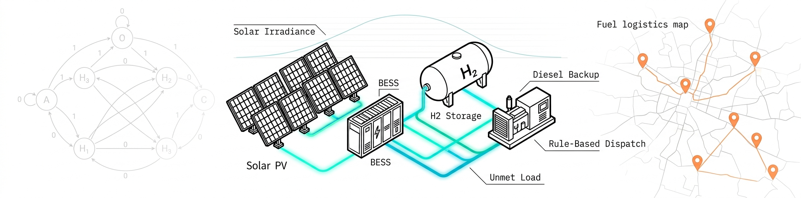
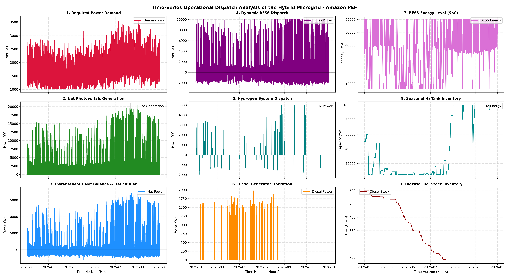

<div align="center">
  
</div>

# **Scenario-Based Dynamic Modeling Framework for Multi-Vector Hybrid Microgrids in Isolated Amazonian Defense Outposts**
> This paper presents a **scenario-based dynamic modeling framework** for **multi-vector hybrid microgrids**, integrating **photovoltaic generation**, **lithium-ion battery storage**, **hydrogen-based seasonal storage**, and a **diesel backup generator** under localized boundary conditions. A **non-homogeneous Markov chain** combined with **solar geometry models** is used to generate stochastic irradiance profiles, while a **multi-layer demand model** represents the volatile load of a remote **Special Border Platoon** (*Pelotão Especial de Fronteira*, PEF). The framework is evaluated over an annual horizon using a **rule-based dispatch strategy**, revealing system-level stress patterns such as battery depletion events, hydrogen saturation, and fuel scarcity under constrained logistics.

## Research Question
Can a stochastic, scenario-based dynamic modeling framework capture the coupled energy–logistics interactions that determine the operational resilience of multi-vector hybrid microgrids in isolated equatorial environments?
Rather than relying on deterministic tools or time-averaged meteorological assumptions, this project builds a **discrete-time simulation environment** that integrates stochastic boundary conditions, multi-vector state-space models, and a baseline dispatch controller.
The research investigates three main questions:

1. Can realistic solar irradiance and tactical demand profiles be generated for a remote Amazonian defense outpost without complete regional telemetry?
2. How do short-term (BESS) and long-term (H₂) storage dynamics interact under seasonal variability and constrained fuel logistics?
3. What system-level stress patterns emerge when a reactive Rule-Based Controller (RBC) is exposed to coupled environmental and logistical constraints?

## Experimental Setup
The experiment investigates the operational behavior of a multi-vector hybrid microgrid composed of photovoltaic generation, battery storage, hydrogen storage, and diesel backup, dispatched by a rule-based controller over a multi-year simulation horizon. The framework is designed to provide a reproducible and physically grounded computational benchmark for future research on predictive and learning-based energy management strategies.

### Overview of the Framework
The simulation framework is organized into three coupled components:

- **Stochastic boundary conditions** for solar irradiance and demand profiles
- **State-space models** for energy storage systems and generation assets
- **Rule-based dispatch strategy** reflecting operational priorities

These components are integrated into a unified **discrete-time simulation environment** (Δt = 1 h) that enables consistent evaluation of system behavior under scenario-driven conditions.

### Dynamic Solar Irradiance Modeling
A hierarchical **stochastic-geometric framework** was developed to model the hourly horizontal solar irradiance G(t) [W/m²] for Manaus, Brazil (Latitude −3.11°), without relying on incomplete regional telemetry.

**Seasonal Factor**

```
SF(d) = 0.5 · (1 − cos(2π · (d − 110) / 365))
```

**Markov-based Weather State Transitions**

```
P_interp(d) = (1 − SF(d)) · T_wet[S_(d−1)] + SF(d) · T_dry[S_(d−1)]
```

where the steady-state transition matrices are parameterized as:

```
T_wet = [ 0.25  0.45  0.30 ]
        [ 0.10  0.50  0.40 ]
        [ 0.05  0.25  0.70 ]

T_dry = [ 0.85  0.12  0.03 ]
        [ 0.45  0.45  0.10 ]
        [ 0.30  0.40  0.30 ]
```

**Deterministic Geometric Envelope (Solar Zenith Angle)**

```
cos(θ_z) = sin(φ) · sin(δ) + cos(φ) · cos(δ) · cos(H)

G_clear(t) = max(0, cos(θ_z)) · G_max,dynamic(d)
```

**Stochastic High-Frequency Disturbances**

```
G_noisy(t) = G_clear(t) · ω_weather(t)
             + N(0, (M_noise(t) · σ_noise)²) · I{cos(θ_z) > 0}
```

The final computed irradiance enforces strict physical caps (1350 W/m²) and applies night/twilight cuts at G_threshold = 45.0 W/m².

### Tactical Electrical Demand Modeling
The total instantaneous power demand P_demand(t) of the isolated Special Border Platoon is modeled as a **multi-layer composition** of persistent defensive infrastructure, stochastic operational missions, and dynamic thermal-cooling mechanisms.

**Elevated Baseline Infrastructure Load**

```
P_base(t) = [0.35 + (0.42 − 0.35) · SF(t)] · P_peak
```

**Stochastic Active Operational Load (GMM)**

```
P_workday(h) = 0.65 · exp(−((h − 10) / 2.5)²)
             + 0.55 · exp(−((h − 15) / 2.0)²)
             + 0.05

P_weekend(h) = 0.35 · exp(−((h − 11) / 3.0)²)
             + 0.40 · exp(−((h − 16) / 2.5)²)
             + 0.05
```

A dual-scale stochastic engine (inter-day σ_daily = 0.25 and intra-day σ_hourly = 0.15) modulates the deterministic profile.

**Dynamic Thermal and Cooling Load (First-order Autoregressive)**

```
E_thermal(t) = [ E_thermal(t−1) · (1 − β_loss)
                 + α_gain · G(t) ] · λ_thermal(t)
```

**Aggregate Compilation with Lower Bound Floor**

```
P_demand,raw(t) = P_base(t) + P_operational(t)
                  + P_thermal(t) + ε(t)

P_demand(t) = max(0.30 · P_peak, P_demand,raw(t))
```

### Microgrid Asset Subsystem Modeling

**Photovoltaic Generation**

```
P_solar(t) = G(t) · (N_panels · A_panel) · η_PV
```

**Multi-Vector Storage (BESS + Hydrogen)**

Each storage vector k ∈ {BESS, H₂} follows a localized state-space capacity model with piecewise conditional logic for charging and discharging, bounded by nominal energy capacity E_cap,k, maximum power P_max,k, and lower safety boundary E_min,k.

```
SoC_k(t) = ( E_k(t) / E_cap,k ) · 100.0
```

**Backup Diesel Generator**

```
         ⎧ V_tank(t−1) − V̇_fuel(t),   if V_tank(t−1) ≥ P_ref(t) · α_fuel · Δt
V_tank(t)=⎨
         ⎩ 0.0,                         otherwise
```

### Rule-Based Controller (RBC)
The system control is governed by a deterministic cascade heuristic that evaluates P_net(t) at each time step:

1. **Condition I (P_net ≥ 0): Surplus Management** — charge BESS → electrolyzer → curtail.
2. **Condition II (P_net < 0): Deficit Management** — discharge BESS → fuel cell → diesel generator.
3. **Condition III: System Breakdown** — if V_tank(t) = 0, remaining deficit is registered as **Unmet Load** (P_unmet(t)).

### System Parameterization

<div align="center">
  <p><strong>Table 1. Calibrated microgrid simulation parameters and subsystem boundary conditions</strong></p>

  <table>
    <tr>
      <th>Subsystem Vector</th>
      <th>Operational Parameter</th>
      <th>Value</th>
      <th>Unit</th>
    </tr>
    <tr><td>General Operational</td><td>Peak Power Demand (P_peak)</td><td>50000.0</td><td>W</td></tr>
    <tr><td>General Operational</td><td>Total Simulation Horizon</td><td>5</td><td>Years</td></tr>
    <tr><td>General Operational</td><td>Annual Simulation Steps</td><td>8760</td><td>Hours</td></tr>
    <tr><td>Photovoltaic Array</td><td>Number of Panels</td><td>42</td><td>—</td></tr>
    <tr><td>Photovoltaic Array</td><td>Unit Panel Area</td><td>2.0</td><td>m²</td></tr>
    <tr><td>Photovoltaic Array</td><td>Conversion Efficiency</td><td>0.22</td><td>—</td></tr>
    <tr><td>Battery Storage (BESS)</td><td>Nominal Energy Capacity</td><td>60000.0</td><td>Wh</td></tr>
    <tr><td>Battery Storage (BESS)</td><td>Maximum Active Power</td><td>10000.0</td><td>W</td></tr>
    <tr><td>Battery Storage (BESS)</td><td>Initial State of Charge</td><td>0.80</td><td>—</td></tr>
    <tr><td>Battery Storage (BESS)</td><td>Charging Efficiency</td><td>0.92</td><td>—</td></tr>
    <tr><td>Battery Storage (BESS)</td><td>Discharging Efficiency</td><td>0.92</td><td>—</td></tr>
    <tr><td>Battery Storage (BESS)</td><td>Lower Safety Boundary</td><td>6000.0</td><td>Wh</td></tr>
    <tr><td>Hydrogen Storage</td><td>Tank Energy Capacity</td><td>100000.0</td><td>Wh</td></tr>
    <tr><td>Hydrogen Storage</td><td>Maximum System Power</td><td>5000.0</td><td>W</td></tr>
    <tr><td>Hydrogen Storage</td><td>Initial Tank Inventory</td><td>0.50</td><td>—</td></tr>
    <tr><td>Hydrogen Storage</td><td>Electrolyzer Efficiency</td><td>0.65</td><td>—</td></tr>
    <tr><td>Hydrogen Storage</td><td>Fuel Cell Efficiency</td><td>0.55</td><td>—</td></tr>
    <tr><td>Hydrogen Storage</td><td>Lower Safety Boundary</td><td>5000.0</td><td>Wh</td></tr>
    <tr><td>Backup Diesel Generator</td><td>Rated Generation Capacity</td><td>10000.0</td><td>W</td></tr>
    <tr><td>Backup Diesel Generator</td><td>Fuel Tank Capacity</td><td>500.0</td><td>L</td></tr>
    <tr><td>Backup Diesel Generator</td><td>Specific Fuel Consumption</td><td>0.25</td><td>L/kWh</td></tr>
    <tr><td>Backup Diesel Generator</td><td>Logistic Refueling Threshold</td><td>50.0</td><td>L</td></tr>
  </table>
</div>

## Results

### Time-Series Operational Analysis
A granular time-series inspection of the simulated multi-vector microgrid operation is presented below. The controller operates through a **deterministic priority-based cascade logic**, where instantaneous photovoltaic generation is first compared against the active electrical demand to compute the net power balance (P_net).

<div align="center">
  
  <p align="center"><strong>Figure 1. Time-series operational analysis of the simulated hybrid microgrid environment. Column 1: primary power balance variables. Column 2: active dispatch behavior of BESS, hydrogen, and diesel under the Rule-Based Controller. Column 3: internal storage states, operational boundaries, and unmet load events.</strong></p>
</div>

### Primary Power Balances and Deficit Thresholds
The system equilibrium is governed by **high-variability demand** and **renewable generation** profiles. The *Required Power Demand* exhibits volatile load behavior, with elevated demand periods concentrated between **August and November** and peak values approaching approximately **3500 W**. The *Instantaneous Net Balance* (P_net = P_PV − P_demand) highlights periods of surplus available for storage charging and deficit conditions associated with potential unmet load events.

### Active Asset Dispatch Trajectories
- **Dynamic BESS Dispatch:** high-frequency bidirectional operation — the battery acts as the primary short-term buffer, continuously compensating for solar ramp fluctuations and demand variability.
- **Hydrogen System Dispatch:** smoother seasonal-scale behavior — the electrolyzer absorbs excess renewable generation during surplus, while the fuel cell dispatches during prolonged shortfalls.
- **Diesel Generator Operation:** utilization concentrated in the **first half** of the simulated horizon, progressively decreasing during high-irradiance periods.

### Capacity States and Logistical Inventories
- **BESS Energy Level:** continuously modulates within operational limits — sustained daily cycling without violating the minimum SoC constraint.
- **Seasonal H₂ Tank Inventory:** remains near low-capacity during the first half of the annual horizon; sustained excess renewable generation during the high-irradiance season progressively increases the stored hydrogen inventory, eventually approaching maximum storage capacity.
- **Logistic Fuel Stock Inventory:** diesel consumption decreases steadily; during periods of elevated renewable availability, diesel utilization approaches near-zero operation.

## Findings
- A **scenario-based dynamic modeling framework** for multi-vector hybrid microgrids in isolated Amazonian defense outposts was proposed and validated.
- The **non-homogeneous Markov chain** combined with **solar geometry models** produced realistic stochastic irradiance profiles without relying on complete regional telemetry.
- A **multi-layer demand model** captured the volatile operational profile of a Special Border Platoon, including baseline infrastructure, stochastic missions, and dynamic thermal loads.
- The **Rule-Based Controller** exposed recurring **battery depletion events**, forcing the BESS to approach its minimum operational boundary during elevated variability.
- Extended **hydrogen storage saturation periods** revealed long-term balancing limitations within the simulated architecture.
- Under delayed fuel resupply conditions, the baseline RBC depleted both short- and long-term storage reserves without anticipatory conservation behavior.
- Fuel depletion (V_tank → 0) resulted in **unmet load events** (P_unmet > 0), representing localized system blackout conditions.
- The framework provides an **open computational benchmark** for future research on predictive and learning-based energy management strategies.

## Limitations and Future Work
- The baseline **Rule-Based Controller** is intentionally reactive and does not implement anticipatory behavior — this is a design choice to expose operational bottlenecks, not a limitation of the framework.
- The simulation horizon is limited to **5 years** with hourly resolution; sub-hourly dynamics (e.g., inverter-level transients) are not captured.
- Fuel logistics are modeled as a threshold-based refueling process; more detailed river-navigation seasonality could be integrated in future work.
- **Future work** will utilize the proposed framework for evaluating advanced energy management strategies:
  - **Model Predictive Control (MPC)**
  - **Deep Reinforcement Learning (DRL)** for multi-vector scheduling under constrained logistics
  - Adaptive thresholding and regime-aware controllers
- Extension to **multi-outpost coordination** and shared fuel logistics is a natural next step.

## References
1. Lasseter, R. H. (2002). *MicroGrids*. IEEE Power Engineering Society Winter Meeting.
2. Rezaei, N., et al. (2021). *Military microgrids: A review of energy resilience strategies*. Renewable and Sustainable Energy Reviews.
3. Sinha, S., & Chandel, S. S. (2014). *Review of recent trends in optimization techniques for solar photovoltaic–wind based hybrid energy systems*. Renewable and Sustainable Energy Reviews.
4. Parra, D., et al. (2019). *An integrated techno-economic and life cycle environmental assessment of power-to-gas systems*. Applied Energy.

## Project Structure
```text
📦 quantyma-article-004
┣ 📂 data
┣ 📂 images
┣ 📂 notebooks
┃ ┣ 📜 01-solar-irradiance-modeling.ipynb
┃ ┣ 📜 02-demand-profile-generation.ipynb
┃ ┣ 📜 03-microgrid-assets.ipynb
┃ ┣ 📜 04-rule-based-controller.ipynb
┃ ┗ 📜 05-results-analysis.ipynb
┣ 📂 src
┃ ┣ 📂 results
┃ ┃ ┗ 📂 figures
┃ ┃   ┗ 📜 microgrid_3columns_subplot.png
┃ ├ 📜 solar_model.py
┃ ├ 📜 demand_model.py
┃ ├ 📜 assets.py
┃ ├ 📜 dispatch.py
┃ ├ 📜 simulation.py
┃ └ 📜 analysis.py
┣ 📜 README.md
┣ 📜 requirements.txt
┗ 📜 LICENSE
```

## Setup, Hardware & Execution

### 1. Hardware & OS Environment (Original Workstation)
The results were obtained using this specific configuration to ensure reproducibility:
- **Host Model:** Lenovo ThinkPad E14 Gen 5 (21JS000SBO)
- **OS:** Debian GNU/Linux 13.4 (Bookworm)
- **CPU:** AMD Ryzen 7 7730U (8-Core / 16-Threads)
- **GPU:** AMD Radeon Graphics (Barcelo)
- **RAM:** 24GB LPDDR4
- **Environment:** Local Research Station

### 2. Installation & Execution Script
Run the commands below to configure the environment and start the experiment:

```bash
# Update system, install dependencies, configure Python environment and run
sudo apt update && sudo apt install curl git -y && \
curl -fsSL [https://pyenv.run](https://pyenv.run) | bash && \
export PATH="$HOME/.pyenv/bin:$PATH" && \
eval "$(pyenv init -)" && \
eval "$(pyenv virtualenv-init -)" && \
pyenv install 3.11.8 && \
pyenv local 3.11.8 && \
curl -sSL [https://install.python-poetry.org](https://install.python-poetry.org) | python3 - && \
export PATH="$HOME/.local/bin:$PATH" && \
poetry config virtualenvs.in-project true && \
poetry install && \
poetry run jupyter notebook src/experiment.ipynb
```

## Know the Author:
<div align="center">
  
</div>
<p align="right">
  <a href="https://www.linkedin.com/in/bpriantti/">
    
  </a>
</p>
