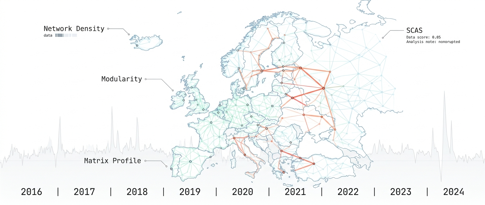
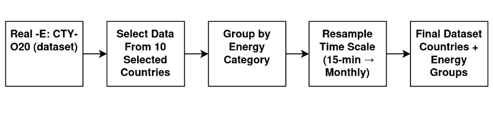
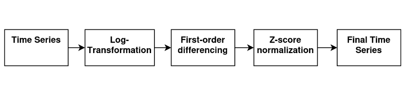
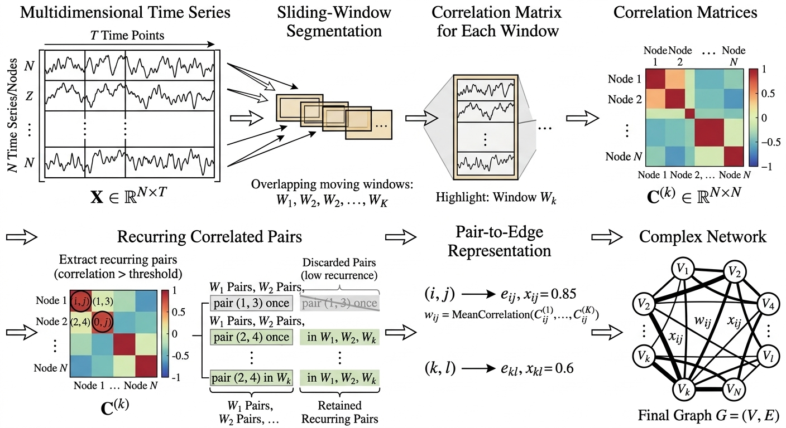
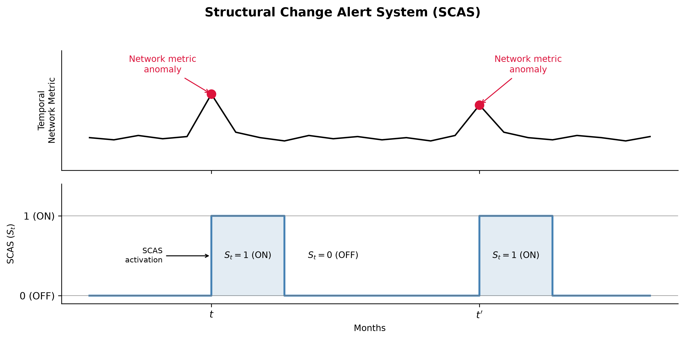
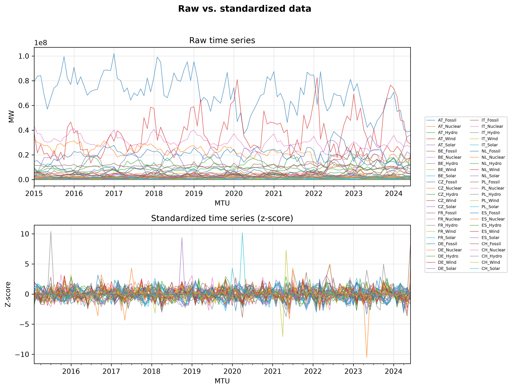
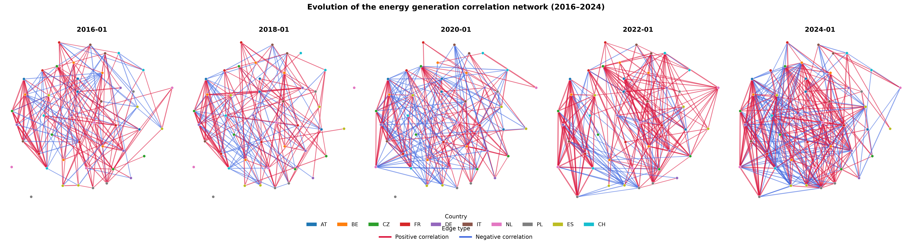
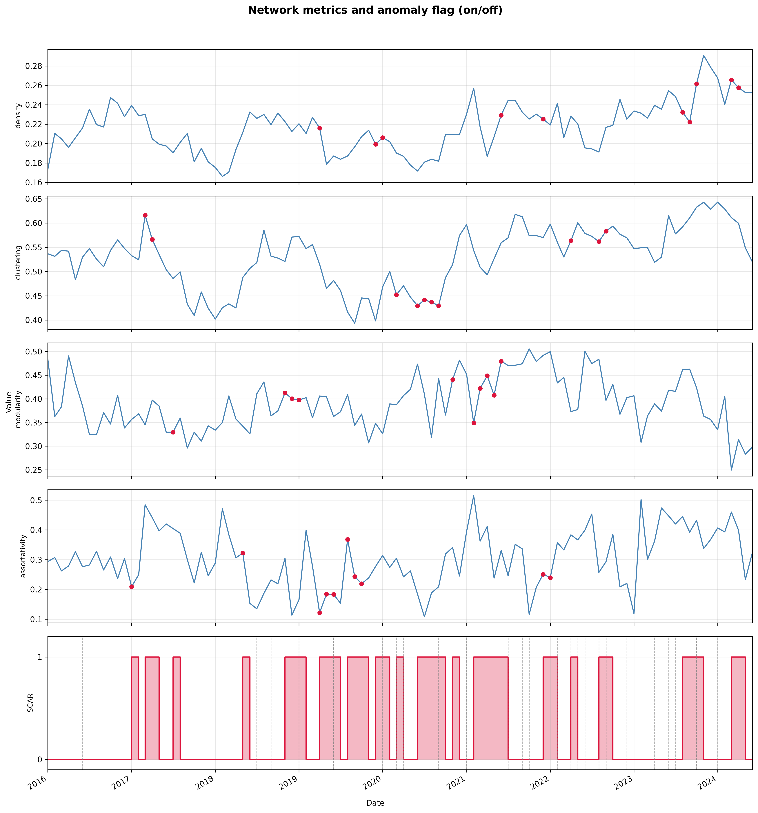

<div align="center">
  <table style="border: 1px solid black;">
    <tr>
      <td style="padding: 0;">
        
      </td>
    </tr>
  </table>
</div>

# **A framework for Detecting Structural Anomalies in European Energy Generation Networks with Event Validation (2016-2024)**
> Detecting structural changes in interconnected energy systems can help reveal how external events affect energy generation patterns. We propose the **Structural Change Alert Signal (SCAS)**, a network-based framework for identifying periods of potential structural change in European energy generation. The analysis uses monthly data from ten countries and five energy categories, applying log-differencing and standardization before constructing sliding-window correlation networks. Four network metrics are calculated for each window: density, clustering, modularity, and assortativity. **Matrix Profile** is then applied to these metrics to identify anomalous temporal patterns, which are combined into a binary SCAS. Across 102 monthly windows from 2016 to 2024, the SCAS identifies periods coinciding with **24 of 29 documented events (82.8%)** within a two-month tolerance window.

## Research Question
Can a network-based anomaly detection framework capture structural changes in European energy generation networks and temporally align them with documented external events?
Rather than assuming stationary relationships, this project builds a **time-varying correlation network** and applies **Matrix Profile** to identify anomalous windows.
The research investigates three main questions:

1. Can structural changes in the correlation network be detected using global network metrics?
2. Do detected anomalies temporally align with documented geopolitical, market, climate, infrastructure, policy, and sanitary events?
3. How does the event match rate compare against a random baseline?

## Experimental Setup
The experiment investigates structural anomalies in European energy generation networks using sliding-window correlation graphs and anomaly detection.

### Overview of the Framework
The experimental framework consists of the following stages:
- Data collection and preprocessing (Real-E benchmark)
- Time series preprocessing (log-differencing and z-score)
- Temporal correlation network construction (rolling window)
- Network metric computation (density, clustering, modularity, assortativity)
- Anomaly detection via Matrix Profile
- Structural Change Alert Signal (SCAS) generation
- Validation against documented events

<div align="center">
  
  <p align="center"><strong>Figure 1. Data Collection and Preprocessing Pipeline.</strong></p>
</div>

### Data Collection and Preprocessing
This study uses the **Real-E benchmark**, constructed from the ENTSO-E Transparency Platform and covering 39 European countries. We adopt the O20 version, which filters variables with an overlapping rate below 20%, yielding a subset with improved temporal coverage.

We use the "Actual Generation per Production Type" subset at the national level (CTY), consolidating the original production types into five broader categories: **Fossil, Nuclear, Hydro, Wind, and Solar**.

From this pool, we select ten major, highly interconnected countries: **Austria, Belgium, Czech Republic, France, Germany, Italy, Netherlands, Poland, Spain, and Switzerland**. The original 15-minute generation data are aggregated into monthly totals, yielding 50 time series (10 countries × 5 categories).

<div align="center">
  
  <p align="center"><strong>Figure 2. Time Series Preprocessing.</strong></p>
</div>

### Time Series Preprocessing
To reduce trend and scale effects, we apply two sequential transformations to each of the 50 time series:

**1. Logarithmic differencing**

```
Y_t = log(1 + X_t)

ΔY_t = Y_t − Y_{t−1} = log(1 + X_t) − log(1 + X_{t−1})
```

**2. Z-score normalization**

```
Z_t = (ΔY_t − μ_ΔY) / σ_ΔY
```

where μ_ΔY and σ_ΔY denote the mean and standard deviation of the differenced series. This step places all 50 time series on a common scale.

### Temporal Correlation Network Construction

<div align="center">
  
  <p align="center"><strong>Figure 3. Temporal Correlation Network Construction.</strong></p>
</div>

We employ a rolling-window approach with a window length of **L = 12 months** and a step size of one month. Given the 113 monthly observations from February 2015 to June 2024, this produces:

```
W = T − L + 1 = 113 − 12 + 1 = 102
```

For each window, pairwise Pearson correlations are computed among the available time series. The resulting correlations form a symmetric matrix:

```
R^(w) = [r_ij^(w)] ∈ [−1, 1]^(50×50)
```

We consider the upper triangular elements, yielding 1,225 unique pairwise correlations per window. Each matrix is transformed into a weighted signed graph:

```
G^(w) = (V, E^(w), W^(w))
```

An edge (i, j) is included when |r_ij^(w)| ≥ τ, with threshold τ = 0.5. The weight is the original correlation: w_ij^(w) = r_ij^(w).

### Network Metrics
For each temporal network, we compute four complementary network metrics:

1. **Density:** Fraction of observed edges relative to all possible edges.
2. **Clustering coefficient:** Tendency of neighboring nodes to be connected.
3. **Modularity:** Strength of division into communities.
4. **Degree assortativity:** Correlation between degrees of connected nodes.

<div align="center">
  <p><strong>Table 1. Network metrics used in this study.</strong></p>

  <table>
    <tr>
      <th>Metric</th>
      <th>What it measures</th>
      <th>Reference</th>
    </tr>
    <tr><td>Density</td><td>Overall connectivity of the network</td><td>Wasserman & Faust (1994)</td></tr>
    <tr><td>Clustering coefficient</td><td>Local cohesion among neighboring nodes</td><td>Watts & Strogatz (1998)</td></tr>
    <tr><td>Modularity</td><td>Strength of division into communities</td><td>Newman (2004)</td></tr>
    <tr><td>Degree assortativity</td><td>Tendency of hubs to connect to other hubs</td><td>Newman (2002)</td></tr>
  </table>
</div>

### Anomaly Detection via Matrix Profile
We apply the **Matrix Profile** algorithm to each of the four metric time series. Subsequences with large distances (discords) represent patterns maximally different from all others. For each metric, we use a subsequence length of **6 months** and retain the **top-5 discords** as candidate anomalies, producing 20 anomaly candidates across the four metrics.

### Structural Change Alert Signal (SCAS)
Whenever an anomaly is detected in any of the four network metrics, the SCAS is activated (S_t = 1). The signal remains active for the subsequent **two months**, after which it returns to S_t = 0, unless another anomaly is detected.

<div align="center">
  
  <p align="center"><strong>Figure 4. SCAS diagram.</strong></p>
</div>

### Validation against Documented Events
An anomaly is considered a match if it falls within a **two-month tolerance** of a documented event.

<div align="center">
  <p><strong>Table 2. Documented events used for validation, grouped by category.</strong></p>

  <table>
    <tr>
      <th>Date</th>
      <th>Event</th>
      <th>Category</th>
    </tr>
    <tr><td>2016-06</td><td>Brexit</td><td>Geopolitical</td></tr>
    <tr><td>2018-07</td><td>Drought and heatwave</td><td>Climate</td></tr>
    <tr><td>2018-09</td><td>CO₂ price crisis</td><td>Market</td></tr>
    <tr><td>2019-01</td><td>German nuclear phase-out (1)</td><td>Infrastructure</td></tr>
    <tr><td>2019-06</td><td>Record heatwave</td><td>Climate</td></tr>
    <tr><td>2019-06</td><td>Clean Energy Package</td><td>Policy</td></tr>
    <tr><td>2020-01</td><td>Brexit formalized</td><td>Geopolitical</td></tr>
    <tr><td>2020-03</td><td>COVID-19</td><td>Sanitary</td></tr>
    <tr><td>2020-04</td><td>Negative oil prices</td><td>Market</td></tr>
    <tr><td>2020-09</td><td>55% renewable target</td><td>Policy</td></tr>
    <tr><td>2021-01</td><td>Biden rejoins Paris Agreement</td><td>Geopolitical</td></tr>
    <tr><td>2021-01</td><td>German nuclear phase-out (2)</td><td>Infrastructure</td></tr>
    <tr><td>2021-07</td><td>Germany/Belgium floods</td><td>Climate</td></tr>
    <tr><td>2021-09</td><td>Gas crisis</td><td>Market</td></tr>
    <tr><td>2021-10</td><td>Global energy crisis</td><td>Market</td></tr>
    <tr><td>2022-02</td><td>Ukraine invasion</td><td>Geopolitical</td></tr>
    <tr><td>2022-04</td><td>French nuclear issues</td><td>Infrastructure</td></tr>
    <tr><td>2022-05</td><td>REPowerEU</td><td>Policy</td></tr>
    <tr><td>2022-06</td><td>Extreme drought</td><td>Climate</td></tr>
    <tr><td>2022-08</td><td>Gas at €300/MWh</td><td>Market</td></tr>
    <tr><td>2022-09</td><td>Nord Stream sabotage</td><td>Geopolitical</td></tr>
    <tr><td>2022-12</td><td>Gas price cap</td><td>Market</td></tr>
    <tr><td>2023-04</td><td>German nuclear phase-out (3)</td><td>Infrastructure</td></tr>
    <tr><td>2023-06</td><td>French nuclear recovery</td><td>Infrastructure</td></tr>
    <tr><td>2023-07</td><td>Hottest July on record</td><td>Climate</td></tr>
    <tr><td>2023-10</td><td>Israel-Hamas war</td><td>Geopolitical</td></tr>
    <tr><td>2023-10</td><td>Electricity market reform</td><td>Policy</td></tr>
    <tr><td>2024-01</td><td>Mild winter</td><td>Climate</td></tr>
  </table>
</div>

## Results

### Time Series Preprocessing
The top panel shows the raw time series (in MW), highlighting heterogeneous scales and outliers. The bottom panel presents the standardized time series via z-score normalization.

<div align="center">
  
  <p align="center"><strong>Figure 5. Time Series Preprocessing.</strong></p>
</div>

### Evolution of Network
The progressive densification and shifting connectivity patterns across snapshots reveal structural changes in the interdependence of energy generation profiles over time. Red edges indicate positive correlations (co-movement), while blue edges indicate negative correlations.

<div align="center">
  
  <p align="center"><strong>Figure 6. Evolution of Network.</strong></p>
</div>

### Temporal Network Metrics
The co-occurrence of anomalies across multiple metrics (e.g., around 2018, 2020, and 2021–2022) suggests periods of structural reconfiguration in the energy generation correlation network.

<div align="center">
  
  <p align="center"><strong>Figure 7. Temporal Network Metrics.</strong></p>
</div>

### Event-Discord Match

<div align="center">
  <p><strong>Table 3. Alignment between documented events and detected discords.</strong></p>

  <table>
    <tr>
      <th>Event Date</th>
      <th>Event</th>
      <th>Category</th>
      <th>Matched</th>
    </tr>
    <tr><td>2016-06</td><td>Brexit</td><td>Geopolitics</td><td>False</td></tr>
    <tr><td>2018-07</td><td>Drought and Heatwave</td><td>Climate</td><td>True</td></tr>
    <tr><td>2018-09</td><td>CO2 Crisis</td><td>Market</td><td>True</td></tr>
    <tr><td>2019-01</td><td>German Nuclear Phase-out (1)</td><td>Infrastructure</td><td>True</td></tr>
    <tr><td>2019-06</td><td>Record Heatwave</td><td>Climate</td><td>True</td></tr>
    <tr><td>2019-06</td><td>Clean Energy Package</td><td>Policy</td><td>True</td></tr>
    <tr><td>2020-01</td><td>Brexit Formalized</td><td>Geopolitics</td><td>True</td></tr>
    <tr><td>2020-03</td><td>COVID-19</td><td>Health</td><td>True</td></tr>
    <tr><td>2020-04</td><td>Negative Oil Prices</td><td>Market</td><td>True</td></tr>
    <tr><td>2020-09</td><td>55% Renewable Energy Target</td><td>Policy</td><td>True</td></tr>
    <tr><td>2021-01</td><td>Biden Rejoins the Paris Agreement</td><td>Geopolitics</td><td>True</td></tr>
    <tr><td>2021-01</td><td>German Nuclear Phase-out (2)</td><td>Infrastructure</td><td>True</td></tr>
    <tr><td>2021-07</td><td>Germany/Belgium Floods</td><td>Climate</td><td>True</td></tr>
    <tr><td>2021-09</td><td>Gas Crisis</td><td>Market</td><td>False</td></tr>
    <tr><td>2021-10</td><td>Global Energy Crisis</td><td>Market</td><td>True</td></tr>
    <tr><td>2022-02</td><td>Invasion of Ukraine</td><td>Geopolitics</td><td>True</td></tr>
    <tr><td>2022-04</td><td>French Nuclear Power Issues</td><td>Infrastructure</td><td>True</td></tr>
    <tr><td>2022-05</td><td>REPowerEU</td><td>Policy</td><td>True</td></tr>
    <tr><td>2022-06</td><td>Extreme Drought</td><td>Climate</td><td>True</td></tr>
    <tr><td>2022-08</td><td>Gas Prices Reach €300/MWh</td><td>Market</td><td>True</td></tr>
    <tr><td>2022-09</td><td>Nord Stream Sabotage</td><td>Geopolitics</td><td>True</td></tr>
    <tr><td>2022-12</td><td>Gas Price Cap</td><td>Market</td><td>False</td></tr>
    <tr><td>2023-04</td><td>German Nuclear Phase-out (3)</td><td>Infrastructure</td><td>False</td></tr>
    <tr><td>2023-06</td><td>French Nuclear Recovery</td><td>Infrastructure</td><td>True</td></tr>
    <tr><td>2023-07</td><td>Hottest July on Record</td><td>Climate</td><td>True</td></tr>
    <tr><td>2023-10</td><td>Israel-Hamas War</td><td>Geopolitics</td><td>True</td></tr>
    <tr><td>2023-10</td><td>Electricity Market Reform</td><td>Policy</td><td>True</td></tr>
    <tr><td>2024-01</td><td>Mild Winter</td><td>Climate</td><td>True</td></tr>
  </table>
</div>

## Discussion
The results indicate that the temporal correlation network exhibits structural reconfigurations in the vicinity of documented exogenous events. Using a ±2-month tolerance window, **24 of 29 events (82.8%)** are matched with at least one anomalous month.

However, comparison with a random baseline shows that this match rate is only moderately above chance: random event dates yield **76.8% ± 6.7%**, corresponding to a gain of **6.0 percentage points** and a z-score of **0.90**, below the conventional 5% significance threshold.

<div align="center">
  <p><strong>Table 4. Match rate against random baseline (tolerance window of ±2 months).</strong></p>

  <table>
    <tr>
      <th>Method</th>
      <th>Match Rate</th>
    </tr>
    <tr><td>Event-based matching</td><td>82.8% (24/29)</td></tr>
    <tr><td>Random baseline (mean)</td><td>76.8% ± 6.7%</td></tr>
    <tr><td>Gain</td><td>+6.0 pp</td></tr>
    <tr><td>z-score</td><td>0.90</td></tr>
  </table>
</div>

Despite the limited statistical evidence, the matched events exhibit consistent structural patterns. Density, clustering, and modularity are the most frequently affected metrics and often co-occur around major episodes such as the **2019 record heatwave**, the **2021 global energy crisis**, and the **2022 invasion of Ukraine**.

## Findings
- A network-based framework (SCAS) was proposed to detect structural changes in European energy generation networks.
- The rolling-window correlation network combined with Matrix Profile successfully identified anomalous temporal patterns.
- The SCAS matched **24 of 29 documented events (82.8%)** within a two-month tolerance window.
- Density, clustering, and modularity were the most relevant metrics for detecting changes.
- The random baseline comparison (**76.8% ± 6.7%**) shows the result is **moderately above chance**, but the z-score of 0.90 indicates exploratory rather than statistically established evidence.
- The co-occurrence of anomalies across multiple metrics around 2018, 2020, and 2021–2022 suggests periods of systemic stress and structural reconfiguration.

## Limitations and Future Work
- The high temporal density of anomalies and the relatively wide tolerance window make random matches likely.
- The limited number of documented events (N = 29) reduces statistical power.
- Both events and anomalies tend to cluster during periods of systemic stress.
- **Future work** will focus on:
  - Sensitivity analyses of network construction and anomaly detection parameters.
  - Larger event datasets to improve statistical power.
  - Additional network descriptors (e.g., path length, centrality measures).
  - Assessing robustness and general applicability to other interconnected energy systems.

## References
1. Trebbien, J., et al. (2024). *Patterns of European energy generation and consumption*. Nature Communications.
2. Rydin, Y., et al. (2022). *Complexity and resilience of European energy systems*. Energy Policy.
3. Baek, Y., et al. (2025). *Detecting non-stationarity in energy time series*. Applied Energy.
4. Han, J., et al. (2022). *Complex network analysis of energy systems: A review*. Renewable and Sustainable Energy Reviews.
5. Yeh, C. C. M., et al. (2016). *Matrix Profile I: All Pairs Similarity Joins for Time Series*. IEEE ICDM.
6. Shao, Z., et al. (2025). *Real-E: A benchmark dataset for European energy systems*. Scientific Data.
7. Wasserman, S., & Faust, K. (1994). *Social Network Analysis: Methods and Applications*. Cambridge University Press.
8. Watts, D. J., & Strogatz, S. H. (1998). *Collective dynamics of 'small-world' networks*. Nature.
9. Newman, M. E. J. (2004). *Fast algorithm for detecting community structure in networks*. Physical Review E.
10. Newman, M. E. J. (2002). *Assortative mixing in networks*. Physical Review Letters.

## Project Structure
```text
📦 quantyma-article-005
┣ 📂 data
┣ 📂 images
┃ ┣ 📜 image_cover.jpeg
┃ ┣ 📜 image_1.png
┃ ┣ 📜 image_2.png
┃ ┣ 📜 image_3.jpeg
┃ ┣ 📜 scas_diagram.png
┃ ┣ 📜 raw_vs_standardized.png
┃ ┣ 📜 evolution_of_network.png
┃ ┗ 📜 network_metrics_time_series.png
┣ 📂 notebooks
┃ ┣ 📜 01-data-collection.ipynb
┃ ┣ 📜 02-time-series-preprocessing.ipynb
┃ ┣ 📜 03-network-construction.ipynb
┃ ┣ 📜 04-matrix-profile-anomaly.ipynb
┃ ┗ 📜 05-event-validation.ipynb
┣ 📂 src
┃ ├ 📜 network_builder.py
┃ ├ 📜 matrix_profile.py
┃ ├ 📜 scas.py
┃ └ 📜 validation.py
┣ 📜 README.md
┣ 📜 requirements.txt
┗ 📜 LICENSE
```

## Reproducibility
Clone the repository and install the required dependencies:

```bash
git clone https://github.com/quantyma/quantyma-research/tree/main/quantyma-article-005
cd quantyma-article-005
pip install -r requirements.txt
```

The notebooks reproduce the main stages of the research, from data collection and network construction to anomaly detection and event validation.

## Data and Code Availability
The source code, datasets, and generated networks are available at the Quantyma Research repository:

🔗 [https://github.com/quantyma/quantyma-research/tree/main/quantyma-article-005](https://github.com/quantyma/quantyma-research/tree/main/quantyma-article-005)


## Setup, Hardware & Execution

### 1. Hardware & OS Environment (Original Workstation)
The results were obtained using this specific configuration to ensure reproducibility:
- **Host Model:** Lenovo ThinkPad E14 Gen 5 (21JS000SBO)
- **OS:** Debian GNU/Linux 13.4 (Bookworm)
- **CPU:** AMD Ryzen 7 7730U (8-Core / 16-Threads)
- **GPU:** AMD Radeon Graphics (Barcelo)
- **RAM:** 24GB LPDDR4
- **Environment:** Local Research Station

### 2. Installation & Execution Script
Run the commands below to configure the environment and start the experiment:

```bash
# Update system, install dependencies, configure Python environment and run
sudo apt update && sudo apt install curl git -y && \
curl -fsSL [https://pyenv.run](https://pyenv.run) | bash && \
export PATH="$HOME/.pyenv/bin:$PATH" && \
eval "$(pyenv init -)" && \
eval "$(pyenv virtualenv-init -)" && \
pyenv install 3.11.8 && \
pyenv local 3.11.8 && \
curl -sSL [https://install.python-poetry.org](https://install.python-poetry.org) | python3 - && \
export PATH="$HOME/.local/bin:$PATH" && \
poetry config virtualenvs.in-project true && \
poetry install && \
poetry run jupyter notebook src/experiment.ipynb
```

## Know the Author:
<div align="center">
  
</div>
<p align="right">
  <a href="https://www.linkedin.com/in/bpriantti/">
    
  </a>
</p>
